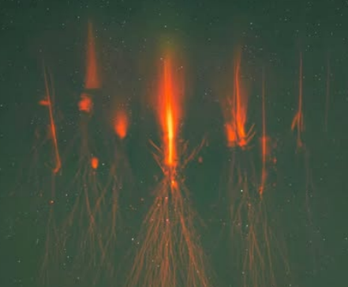

# User-provided Underworld atmosphere reference

Provided by the user on 3 October 2026 as the Underworld lighting concept.
The original attachment is preserved unchanged. It is a visual reference,
not an authored project texture, cubemap, or installed game asset.

Use its dark green atmospheric depth, localized warm orange vertical light,
layered root/vegetation silhouettes and isolated luminous accents as the mood
target. Keep the world visibly underground, with no white surface sky or sky
tree. Translate the reference into playable visibility: local surfaces and the
character should remain readable without making the entire environment bright.
Avoid crushed character shading and blown-out highlights. Neutral lighting on
the asset study sheets exists to inspect form and materials, not to specify
the world's ambient illumination.
